---

## 🔭 About

I like software that doesn't need permission from a cloud provider to run. Most of what I build starts as "can this work fully offline?"

**Currently:**
- 🧠 **JARVIS** — a fully local AI assistant (Ollama + FastAPI + RAG), zero cloud dependency
- 🏗️ an ERP + AI integration platform
- 📚 deep in retrieval-augmented generation and multimodal AI (OCR, speech, image gen)

---

## 🛠️ Stack

<table>
<tr>
<td valign="top" width="50%">

**Languages**

**Databases**

</td>
<td valign="top" width="50%">

**AI / ML**

**Backend & Tools**

</td>
</tr>
</table>

---

## 📌 Featured Builds

<table>
<tr>
<td width="33%" valign="top">

### 🤖 [JARVIS](https://github.com/Mathesh-Chand-K-V/JARVIS---Local-AI-Assistant)
Fully local AI assistant powered by Ollama — RAG, OCR, speech-to-text, TTS, and image generation in one modular FastAPI backend. No cloud dependency, no API keys, no data leaving the machine.

`Python` `FastAPI` `PostgreSQL` `Ollama`

</td>
<td width="33%" valign="top">
  
### 🛡️ [Cybersecurity Incident Management System](https://github.com/Mathesh-Chand-K-V/Cybersecurity-Incident-Management-System)

A role-based incident management system for reporting, tracking, and managing cybersecurity incidents, with dedicated workflows for users, analysts, and administrators.

`Java` `MySQL` `JDBC` `Maven`

</td>
<td width="33%" valign="top">

### 🔍 [Smart OCR System](https://github.com/Mathesh-Chand-K-V/Smart-OCR-System)
A computer-vision OCR pipeline — preprocessing, text detection, and recognition tuned for high-accuracy extraction.

`Python` `OpenCV`

</td>
</tr>
</table>

---

---

## 📊 GitHub Activity & Commit Analytics

<picture>
  <source media="(prefers-color-scheme: dark)" srcset="./assets/cadence.dark.svg" />
  
</picture>

<picture>
  <source media="(prefers-color-scheme: dark)" srcset="./assets/repositories.dark.svg" />
  
</picture>

<picture>
  <source media="(prefers-color-scheme: dark)" srcset="./assets/overview.dark.svg" />
  
</picture>

---

### 💬 Open to talking local LLMs, RAG pipelines, or why the cloud is optional

